# Дизайн-справочник, доступность «Обзора», ловушка фокуса — 17.10.2026

Уровень **M** + UI/UX-трек. Ветка `claude/design-guide`.
Статус: **реализовано, дизайн-ревью пройдено, `check.sh` зелёный; ждёт финального ревью**.

## Цель

Пункты P2 из `docs/TODO.md` (блок «00»):

1. `docs/design-guide.md` — живой справочник по существующей системе: токены,
   темы, паттерны, мобильная ширина, safe area, тон текстов. Описываем то, что
   есть в коде, со ссылками на классы и файлы. Расхождения — списком долга.
2. Доступность «Обзора»: список `KNOWN` в `frontend/browser-tests/a11y.spec.ts`
   пустеет, кроме осознанного `meta-viewport`.
3. Ловушка фокуса в `BottomSheet`: Tab и Shift+Tab не выходят из открытой
   шторки.
4. `AGENTS.md` (UI/UX-трек ссылается на готовый справочник) и бэклог.

Не входит в задачу:

- новая дизайн-система, редизайн, перенос концептов `ui-redesign-concepts/`;
- чистка легаси-токенов (`--text-tertiary`, `--bg-surface`, `--radius-*` и т.п.)
  и прямых hex из `scripts/css-hex-baseline.txt` — только перечисляем как долг;
- доступность других экранов (Портфель, Кредиты, Настройки). `role="button"` в
  `Credits.tsx` — в долг справочника;
- скиллы ревьюеров `.claude/skills/*` (отдельный пункт TODO).

## Решения владельца (аппрув плана 17.10.2026)

«План утверждаю: цвета и div role="button" для категорий — как предложено.»

1. Цвета: светлая `--text-2` `#50545B`, `--text-3` `#676B73`; тёмная
   `--text-3` `#83878F`. Скриншоты до/после — в отчёте.
2. Категории и группы — `div role="button"`.

## Что нашли при диагностике

**Контраст.** axe считает по WCAG (норма 4.5:1 для обычного текста). Фоны, на
которых лежит вторичный текст: `--bg`, `--surface`, `--surface-inset`.

| Токен | Значение сейчас | `--bg` | `--surface` | `--surface-inset` |
|---|---|---|---|---|
| светлая `--text-2` | `#646870` | 4.90 | 5.59 | 5.12 |
| светлая `--text-3` | `#9AA0A8` | **2.31** | **2.64** | **2.41** |
| тёмная `--text-2` | `#9CA0A7` | 7.54 | 6.77 | 6.21 |
| тёмная `--text-3` | `#62666D` | **3.43** | **3.08** | **2.82** |

В светлой теме `--text-2` сам едва выше нормы. Если поднять только `--text-3`
до 4.5, он почти совпадёт с `--text-2` (4.68 против 4.90) — иерархия пропадёт.
Поэтому в светлой теме темнеют оба токена, в тёмной — только `--text-3`.

**Разметка hero.** `Dashboard.tsx`: `<dl class="hero__rows">` содержит
`
`, внутри `<dt>`/`<dd>`. По спецификации у `dl` дети —
только `dt`/`dd` или `div` без роли. Кнопка внутри списка определений ломает
обе структуры.

**Разметка категорий.** `<ul class="catgrid">` и `<ul class="groups">`
содержат `<li role="button">`. Роль кнопки снимает с `li` роль пункта списка,
и `ul` остаётся «без пунктов». В сиде нет групп, поэтому axe видит только
`catgrid`, но у групп тот же дефект. Внутри `li.group` лежит `ul.group__legend`
(блочный контент) — настоящий `<button>` там невалиден.

**`BottomSheet`.** С 16.10 шторка — `role="dialog"`, `aria-modal`, Escape
закрывает верхнюю, фокус возвращается на открывшую кнопку. Tab же уходит на
страницу под шторкой. Стек открытых шторок `openSheets` уже есть — ловушке
нужен только он и обработчик `keydown`, который там уже висит.

## Решения

### 1. Контраст

| Токен | Было | Станет | `--bg` | `--surface` | `--surface-inset` |
|---|---|---|---|---|---|
| светлая `--text-2` | `#646870` | `#50545B` | 6.66 | 7.61 | 6.96 |
| светлая `--text-3` | `#9AA0A8` | `#676B73` | 4.68 | 5.35 | 4.89 |
| тёмная `--text-3` | `#62666D` | `#83878F` | 5.49 | 4.93 | 4.52 |

Тёмная `--text-2` (`#9CA0A7`) не меняется. Иерархия сохраняется: в светлой
теме шаг `--text` → `--text-2` → `--text-3` остаётся различимым (17.3 → 6.7 →
4.7 на `--bg`), в тёмной — (18.2 → 7.5 → 5.5).

Значения меняются в трёх местах: `:root`, `[data-theme="dark"]` и
`@media (prefers-color-scheme: dark)`.

Побочный эффект: `--text-3` также цвет плейсхолдеров и шевронов — они станут
темнее. Это ожидаемо и видно на снимках.

### 2. Hero — настоящие кнопки

`<dl class="hero__rows">` → `
`. Каждая строка —
`<button type="button" class="hero__row">` с ``
и `` вместо `dt`/`dd`. Самописные `onKeyDown`
удаляются: Enter и пробел у `<button>` нативные. Проверка
`suppressClickUntilRef` в `onClick` сохраняется. В CSS: `.hero__row dt/dd` →
`.hero__row-label/-value` и сброс стилей кнопки (`font: inherit`, фон, рамка,
`width: 100%`, `text-align`), плюс `:focus-visible` как у `.cat`.

### 3. Категории и группы — без списка

`<ul class="catgrid">`/`<ul class="groups">` → `
`, пункты `<li>` → `
`
с тем же `role="button"`, `tabIndex`, Enter/пробел (они уже есть).
Разделители `catgrid__sep` → `
`. Внутренний
`ul.group__legend` остаётся списком — он теперь внутри `div`, а не `li`.

Почему не `ul > li > button`: у групп внутри блочный контент, а кнопка —
это перетаскивание (`draggable`) с целым набором drag-обработчиков. Перенос их
на вложенный элемент меняет сетку `.catgrid` (грид-элементы — сами `.cat`) и
поведение drag&drop без выгоды для пользователя. Цена — экранный диктор не
говорит «список, 12 пунктов». Вариант с `<button>` — в «Вопросы владельцу».

### 4. Ловушка фокуса

В существующем `handleKeyDown` в `BottomSheet.tsx`: если шторка верхняя
(`openSheets`) и нажат Tab — найти видимые фокусируемые элементы внутри
`sheetRef` (`a[href]`, `button`, `input`, `select`, `textarea`,
`[tabindex]:not([tabindex="-1"])`, без `disabled`). Если фокус на последнем
(или вне шторки) и Tab — на первый; на первом (или на самой шторке) и
Shift+Tab — на последний; `preventDefault`. Без новых зависимостей.
Вложенные шторки: ловит только верхняя.

`inert` на остальной странице не берём: шторки рендерятся внутри страниц, а не
порталом, и `inert` на соседях пришлось бы раздавать вручную.

### 5. `meta-viewport`

`user-scalable=no` остаётся: в Telegram WebApp зум ломает вёрстку и жесты.
Остаётся в `KNOWN` с комментарием и описывается в справочнике.

## Критерии приёмки

1. `docs/design-guide.md` существует и покрывает: цветовые токены (новые и
   легаси), отступы, радиусы, типографику (Onest, `tabular-nums`, размеры),
   тени; светлую/тёмную тему и как выбирается тема (Telegram /
   `prefers-color-scheme` / `data-theme`); паттерны `BottomSheet`, шторки
   действий, строки операций с раскрытием и «Отменить», строки позиций
   портфеля, пикеры, формы сумм с десятичной запятой, пустые состояния,
   загрузку, ошибки; ширину 375–430 и safe area; тон и язык текстов;
   исключение `user-scalable=no`; список долга.
2. Каждое утверждение справочника о компоненте ссылается на реальный файл или
   CSS-класс (проверка: все упомянутые классы находятся `grep` в
   `styles.css`/`src`).
3. `--text-3` ≥ 4.5:1 на `--bg`, `--surface`, `--surface-inset` в обеих темах;
   `--text-2` светлой темы ≥ 6:1 на тех же фонах.
4. Hero «Обзора»: строки — `<button>`, без `dl`/`dt`/`dd`; клик и клавиатура
   открывают то же, что раньше (шторка счёта, Портфель, Кредиты).
5. Категории и группы «Обзора»: нет `li[role=button]`; клик и Enter открывают
   категорию.
6. `KNOWN` в `a11y.spec.ts` содержит только `meta-viewport`; axe проходит в
   обеих темах.
7. В открытой `BottomSheet` Tab с последнего элемента переводит фокус на
   первый, Shift+Tab с первого — на последний; фокус ни разу не выходит за
   пределы `role=dialog`.
8. Визуальные эталоны обновлены осознанно; скриншоты «до/после» (390px, обе
   темы) — в отчёте.
9. `AGENTS.md`: UI/UX-трек ссылается на справочник без пометки «пока нет»;
   `docs/TODO.md` — пункты отмечены.
10. Полный `scripts/check.sh` зелёный.

## Что сделано

1. `BottomSheet.tsx`: функция `trapTab` в существующем `keydown` верхней
   шторки. Фокусируемые элементы — видимые (`getClientRects`), без
   `disabled`. С последнего Tab → первый, с первого (или с самой шторки)
   Shift+Tab → последний. Фокус вне шторки возвращается внутрь. Сначала
   написан тест `browser-tests/keyboard.spec.ts`, он упал на старом коде
   (`Tab #7` в светлой теме, `Tab #8` в тёмной), после правки прошёл.
2. `styles.css`: светлая `--text-2` `#646870` → `#50545B`, `--text-3`
   `#9AA0A8` → `#676B73`; тёмная `--text-3` `#62666D` → `#83878F` (в
   `[data-theme="dark"]` и в media-блоке).
3. `Dashboard.tsx`: hero — `
` и
   `<button type="button" class="hero__row">` с `.hero__row-label` /
   `.hero__row-value`, самописные `onKeyDown` убраны. CSS: сброс вида кнопки
   (`font: inherit`, без фона и рамки, `text-align: left`) и
   `.hero__row:focus-visible`. Селекторы `.hero__row dt/dd` переименованы. В
   `scripts/css-hex-baseline.txt` поменялись два селектора, цвета те же
   (194 записи, как было).
4. `Dashboard.tsx`: `ul.catgrid`/`ul.groups` → `div`, карточки `li` → `div` с
   прежними `role="button"`, `tabIndex`, Enter/пробел. Вложенный
   `ul.group__legend` остался списком. Глобальный сброс `ul` в CSS на вид не
   влиял, стили карточек не менялись.
5. `a11y.spec.ts`: в `KNOWN` остался только `meta-viewport` с комментарием.
6. Снимки: все шесть эталонов перегенерированы (`--update-snapshots=all`).
   Обычный прогон их **не уронил**: смена `--text-2/--text-3` укладывается в
   порог сравнения Playwright (`threshold: 0.2`). Изменение проверено по
   пикселям: в подписи навбара самый тёмный пиксель «до» — `R=154` (`#9A`),
   «после» — `R=103` (`#67`); на снимке «Обзора» отличаются 6606 пикселей.
   Правило про `--update-snapshots=all` дописано в `AGENTS.md`.
7. `docs/design-guide.md` — справочник. Все упомянутые CSS-классы, файлы и
   функции проверены скриптом по `styles.css` и `frontend/src`.
8. `AGENTS.md`: UI/UX-трек ссылается на справочник без «пока нет», правило
   обновлять справочник вместе с правкой токена. `docs/TODO.md`: три пункта P2
   закрыты, долг справочника — отдельным пунктом.
9. Ветка перенесена на локальный `main`: там 6 неотправленных коммитов с
   документами (ревизия бэклога, записи о деплоях). Без них `docs/TODO.md`
   конфликтовал бы.

## Скриншоты до и после

390×844, синтетический сид, Linux-образ Playwright. Файлы в
`docs/assets/2026-10-17-design-guide/`.

| | До | После |
|---|---|---|
| Обзор, светлая | 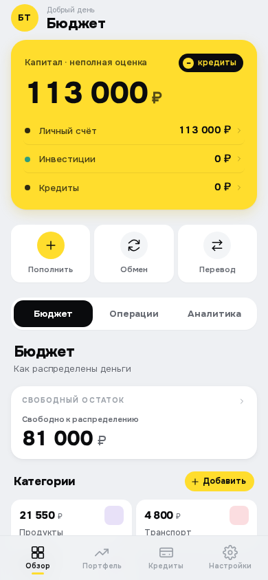 | 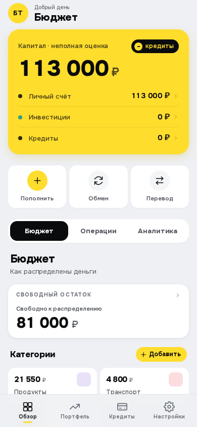 |
| Обзор, тёмная | 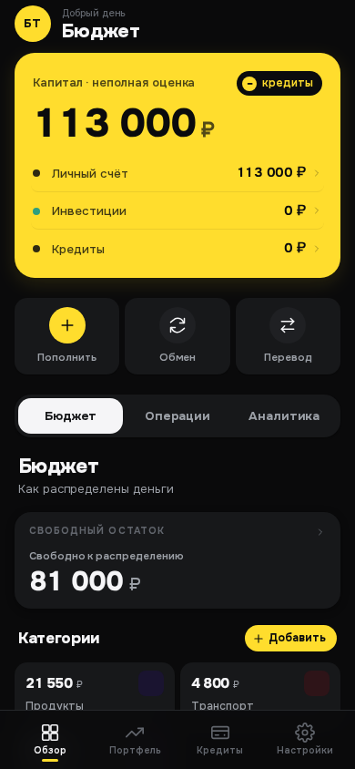 | 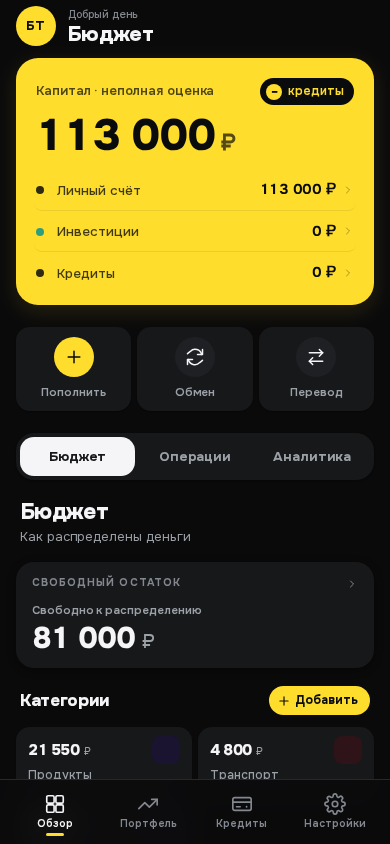 |
| Пополнение, светлая | 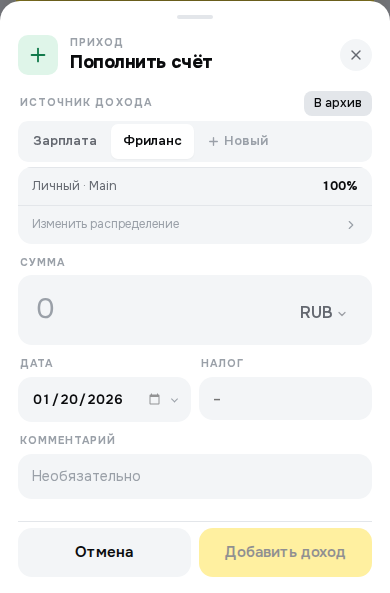 | 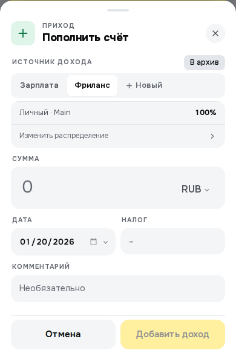 |
| Пополнение, тёмная | 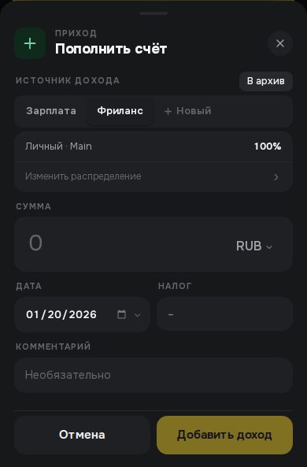 |  |
| Отмена, светлая | 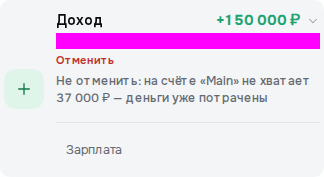 | 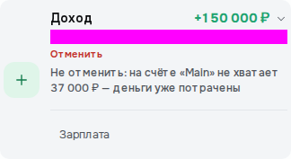 |
| Отмена, тёмная | 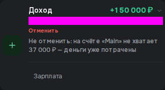 | 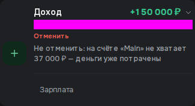 |

## Критерии приёмки и тесты

| # | Критерий | Тест |
|---|---|---|
| 1, 2 | Справочник покрывает разделы, ссылки реальные | скрипт сверки классов/файлов (п. 7 выше), ревью |
| 3 | Контраст `--text-2/--text-3` | axe `color-contrast` в `a11y.spec.ts`, обе темы; расчёт — таблица в «Решениях» |
| 4 | Hero — кнопки, клик и Enter работают | `keyboard.spec.ts` «overview hero rows…»: Enter на «Личный счёт» → шторка, клик «Инвестиции» → Портфель |
| 5 | Категории без `li[role=button]`, клик и Enter открывают | axe `list`; `smoke.spec.ts` (Enter на «Продукты» → шторка) |
| 6 | `KNOWN` — только `meta-viewport` | `a11y.spec.ts` |
| 7 | Ловушка фокуса | `keyboard.spec.ts` «focus stays inside…»: N+2 нажатий Tab и Shift+Tab, после каждого фокус внутри `[role=dialog]` |
| 8 | Эталоны обновлены осознанно | раздел «Скриншоты до и после» |
| 9 | `AGENTS.md`, `TODO.md` | дифф |
| 10 | `scripts/check.sh` | полный — GREEN, 17.10.2026 (браузерных тестов 15 + 1 пропуск по теме) |

## Затронутые области

- `frontend/src/styles.css`, `frontend/src/pages/Dashboard.tsx`,
  `frontend/src/components/BottomSheet.tsx`;
- `frontend/browser-tests/a11y.spec.ts`, новый `keyboard.spec.ts`, снимки
  `*-snapshots/*.png`; `scripts/css-hex-baseline.txt`;
- `docs/design-guide.md` (новый), `docs/assets/2026-10-17-design-guide/`,
  `AGENTS.md`, `docs/TODO.md`.

Миграций БД нет. Бэкенда не касается.

## Откат

`git revert` коммитов ветки. Данных и схемы задача не меняет.

## Известные уязвимости / осознанные риски

- `user-scalable=no` — отступление от WCAG 1.4.4, решение владельца из-за
  Telegram WebApp. Описано в справочнике, остаётся в `KNOWN`.
- Карточки категорий — `div role="button"`, а не список с кнопками (решение
  владельца): диктор не объявляет число категорий.

## Открытые вопросы

- Долг справочника (раздел 9 `design-guide.md`) — отдельные задачи, пункт в
  `docs/TODO.md`.
- Порог визуальных снимков не ловит смену токена цвета. Ужесточать ли
  `threshold` — отдельное решение: с жёстким порогом снимки чаще падают от
  сглаживания.

## Дизайн-ревью

17.10.2026, дизайн-сессия UI/UX-трека. Синтетический сид
(`scripts/seed_ui_test.py`) на одноразовом `postgres:17`, тот же стенд, что
`scripts/browser-tests.sh`; снимки — временным Playwright-тестом в Linux-образе,
390×844, светлая и тёмная тема. Тест в git не попал.

### Что проверено

1. **«Обзор»** (обе темы): hero-строки — `<button>`, вид совпадает со снимком
   «после». Карточки категорий — `div role="button"`, сетка не изменилась.
   Фокус-рамка `.hero__row:focus-visible` на жёлтом hero — чёрная 2px,
   хорошо видна (`review-hero-focus-light-linux.png`); на `.cat` — жёлтая.
2. **Шторка категории** «Продукты» и **«Пополнить»**: теги `.fl`/`.sheet__tag`
   на `--text-3`, плейсхолдеры, подписи — читаются в обеих темах, ничего не
   слилось с фоном. Шторки совпадают со снимками «после».
3. **Иерархия текста.** Посчитал контраст новых значений — совпадает с
   таблицей «Решения». Светлая тема: `--text-2` к `--text-3` — 1.42:1, шаг
   меньше прежнего, но заголовок раздела (`--text`), подзаголовок
   «Как распределены деньги» (`--text-2`) и капс-теги (`--text-3`)
   различаются ещё и размером/весом/капсом — иерархия читается. «Посерения»
   нет: вторичный текст стал темнее, а не светлее.
4. **Ink-hero** (`.hero--ink`, экран «Кредиты»): фокус-рамка — полупрозрачная
   жёлтая, видна на тёмном фоне (`review-ink-hero-focus-dark-linux.png`).
   Здесь же найдена регрессия (ниже).
5. **Справочник** сверен с кодом: все упомянутые CSS-классы есть в
   `styles.css`, файлы и компоненты существуют, значения цветовых токенов и
   радиусов совпадают с `:root` / `[data-theme="dark"]` / media-блоком,
   типографика — по правилам классов. Покрытие по списку задачи полное.
6. **Доступность**: `a11y.spec.ts` (axe, обе темы) и `keyboard.spec.ts`
   (ловушка Tab, hero с клавиатуры) — зелёные в полном `check.sh`.

### Что поправлено

- `cd4050b` — **регрессия на «Кредитах».** Задача переименовала селекторы
  `.hero__row dt/dd` → `.hero__row-label/-value`, а hero «Кредитов»
  (`.hero--ink`) остался на `dl/dt/dd`: точка слиплась с подписью, сумма
  потеряла жирность и цвет. Строки переведены на ту же разметку, что в
  «Обзоре» (`<button>` + `.hero__row-label/-value`), самописный `onKeyDown`
  убран — Enter/пробел нативные. Снимки:
  `review-credits-broken-light-linux.png` → `review-credits-fixed-light-linux.png`.
  Визуальных эталонов «Кредитов» нет, существующие снимки не меняются.
- `b215430` — **справочник**: `.sheet--gray` на `--bg-deep` только при явной
  тёмной теме; `letter-spacing` суммы hero −.045em; стрелки `#9AA0A8` — в семи
  селектах, не в одном; тёмный легаси `--text-tertiary` тоже ниже нормы
  (3.4:1); 27 размеров шрифта, а не 12; пример пустого состояния —
  `AccountDetailSheet`, а не `CurrencyReserveBalances`; описаны hero-строки
  «Кредитов» и их фокус. Долг: пункт 4 переписан (`div role="button"` вне
  «Обзора» больше нет, но axe проверяет только «Обзор»), в пункт 6 добавлен
  реальный разъезд тёмных значений, новый пункт 11 — ~15 текстов на «ты».

### Вернуть автору

1. Строки hero на «Кредитах» — переключатели фильтра, но без
   `aria-pressed`: диктор не говорит, какой фильтр включён. Это поведение, а не
   вид, — решить, нужно ли (`Credits.tsx`, `filterTab`).
2. Регрессия «Кредитов» не была поймана тестами: ни снимка, ни axe на этом
   экране. Стоит ли добавлять снимок `.hero--ink` — на усмотрение автора/финального
   ревью (сейчас это долг 4 справочника).
3. `.sheet--gray` в режиме `system` + тёмная ОС — фон `--bg`, а не `--bg-deep`
   (CSS-правило есть только для `[data-theme='dark']`). Разница едва заметна,
   записано в долг 6; чинить вне этой задачи.

### Ответ автора

1. `aria-pressed` добавлен строкам hero «Кредитов» (`Credits.tsx`).
2. В `a11y.spec.ts` новый тест: «Кредиты» — axe в обеих темах и переключение
   `aria-pressed` у «Карты». Он поймал бы регрессию `cd4050b`: `dl`/`dt`/`dd`
   внутри кнопки axe помечает (`definition-list`, `dlitem`). Снимок
   `.hero--ink` не добавлял — долг 4 справочника.
3. `.sheet--gray` в `system` — оставлен в долге 6.

### Итог

Полный `scripts/check.sh` после правок — **GREEN**, 17.10.2026 (браузерных
тестов 15 + 1 пропуск по теме). Дизайн-ревью пройдено, дальше — финальное ревью.
